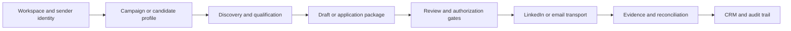

<div align="center">

# HuntFlow
### LinkedIn outreach, job applications, and CRM

[](#development-status)
[](requirements/base.txt)
[](openoutreach/settings.py)
[](LICENCE.md)

[Get started](#quick-start) · [How to use](docs/USAGE.md) · [Architecture](docs/ARCHITECTURE.md) · [Models and configuration](docs/CONFIGURATION.md)

</div>

---

## What HuntFlow does

HuntFlow is a self-hosted Django application for LinkedIn outreach, email campaigns, candidate profiles, job applications, and CRM tracking. It extends the open-source [OpenOutreach](https://github.com/eracle/OpenOutreach) codebase with a HuntFlow dashboard, career workflows, workspace controls, approval gates, and audit views.

**It includes code that sends LinkedIn connection requests and messages, follows up with connections, and submits supported LinkedIn Easy Apply job applications.** These are real external actions when an operator connects an account, configures a campaign, authorizes the workflow, and runs the worker. This public repository does not contain a connected account, personal database, credentials, browser session, resume, or live activity history.

## Development status

> **HuntFlow is still in development.** This is a sanitized source release of an evolving application, not a finished hosted service or a claim that every LinkedIn page, application form, provider, or multi-tenant scenario is ready for production.

The source includes many targeted regression tests, but some historical workflows remain specialized and require further generalization. A successful local test does not establish that live LinkedIn interactions will succeed. No live messages or applications were sent as part of preparing this repository.

## Feature map

| Area | Implemented building blocks | Practical boundary |
|---|---|---|
| LinkedIn outreach | Search, profile retrieval, connection notes, requests, conversation synchronization, follow-ups | Requires the operator's authenticated session and configured action gates; provider changes may break automation |
| Email outreach | Work-email resolution, SMTP mailbox routing, AI-generated openers and message tracking | Optional external services and a sending mailbox are configured by the operator |
| CRM | Leads, deals, campaign states, imports, suppression records, drafts and audit events | The repository starts without customer data |
| Career workspace | PDF/DOCX extraction, candidate fact drafts, versioned profiles, identity review and approved facts | Review extracted facts before using them in an application |
| Job workflow | Search filters, discovery, job matching, application preparation, answer-bank handling and Easy Apply submission | Unsupported questions or uncertain outcomes require human review |
| Documents | Resume/cover-letter generation and ATS-oriented analysis | Drafts are grounded in candidate evidence; do not treat scoring as a hiring guarantee |
| Workspace administration | Membership roles, sender identities, quotas, automation settings and isolation checks | Billing/provider integration and historical operator-specific workflows remain development work |
| Operations | Persistent queue, scheduling, account leases, safety stops, readiness views and reconciliation | Operate deliberately; the dashboard is not evidence of an external success by itself |

## Workflow at a glance



For outreach, HuntFlow discovers profiles, embeds their text, uses active learning to prioritize qualification, drafts relevant messages, and records the resulting campaign state. For applications, it combines approved candidate facts with a verified job record, creates a document package, answers supported questions, and distinguishes attempted submission from confirmed success.

## Tech stack

| Layer | Technology |
|---|---|
| Application and UI | Python, Django, server-rendered templates, CSS, Django Admin, WhiteNoise |
| Browser automation | Playwright Chromium, bundled `linkedin-agent-cli`, provider session management |
| Data | SQLite for local development; PostgreSQL for the deployment configuration; Redis for shared caching |
| AI orchestration | PydanticAI with configurable hosted providers or an OpenAI-compatible endpoint; Ollama integration |
| Retrieval and qualification | FastEmbed, `BAAI/bge-small-en-v1.5` embeddings, scikit-learn Gaussian Process regression and BALD acquisition |
| Candidate documents | pypdf, python-docx, ReportLab, evidence-based ATS analysis |
| Runtime | Gunicorn, Docker Compose, separate web/worker/scheduler/bootstrap services |
| Testing | pytest, pytest-django, factory-boy, mocks and browser-focused regression coverage |

### Which models are used?

- **Profile embeddings:** the source defaults to `BAAI/bge-small-en-v1.5`, producing 384-dimensional vectors.
- **Lead qualification prioritization:** a scikit-learn `GaussianProcessRegressor` learns from positive/negative qualification decisions. It alternates between predicted relevance and information gain; it is not a separately pretrained LLM.
- **Language generation:** the provider and model are configurable in `SiteConfig`. Adapters exist for OpenAI, Anthropic, Google, Groq, Mistral, Cohere, compatible endpoints, and Ollama. An adapter's presence is not a claim that every current model has been tested.
- **Local ATS generation:** the source falls back to the Ollama model name `qwen2.5:1.5b` unless `OLLAMA_MODEL` or the saved Ollama configuration overrides it. Download that model yourself if you choose this route. No model weights are included.

## Quick start

Use a new checkout and a Python 3.12 virtual environment. Start with the dashboard; connecting a provider and running a worker is a separate step.

```bash
git clone https://github.com/awanafnan17/huntflow.git
cd huntflow
python3.12 -m venv .venv
source .venv/bin/activate
python -m pip install --upgrade pip
python -m pip install -r requirements/local.txt
cp .env.example .env
python - <<'PYSETUP'
from pathlib import Path
from secrets import token_urlsafe, token_bytes
from base64 import urlsafe_b64encode
p = Path('.env')
with p.open('a') as out:
    out.write(f"\nDJANGO_SECRET_KEY={token_urlsafe(48)}\n")
    out.write(f"TOKEN_PEPPER={token_urlsafe(48)}\n")
    out.write(f"HUNTFLOW_CREDENTIAL_ENCRYPTION_KEY={urlsafe_b64encode(token_bytes(32)).decode()}\n")
PYSETUP
mkdir -p data
python manage.py migrate
python manage.py setup_crm
python manage.py createsuperuser
python manage.py runserver 127.0.0.1:8000
```

Open **http://127.0.0.1:8000/dashboard/** and sign in with the account you created. Django Admin is available at **http://127.0.0.1:8000/admin/**. The local `.env` template contains no real keys. Generate private keys as described in [configuration](docs/CONFIGURATION.md) before configuring integrations.

For provider-enabled work, install the browser with `python -m playwright install chromium`, configure your sender and account through the dashboard, review the campaign and limits, and start the worker only when ready:

```bash
python manage.py rundaemon
```

The daemon can perform real actions when configured. See the complete [usage guide](docs/USAGE.md) before enabling automation. The application is not affiliated with or endorsed by LinkedIn; account owners remain responsible for provider rules, permissions, and the content they send.

## Repository structure

```text
huntflow/
├── openoutreach/             # Application package retains its upstream name
│   ├── core/                # Workspaces, queue, scheduling, model routing, gates
│   ├── linkedin/            # Sessions, browser/API adapters, discovery, outreach
│   ├── career/              # Candidate facts, jobs, ATS documents, applications
│   ├── dashboard/           # HuntFlow web interface
│   ├── crm/                 # Leads, deals, imports, suppression records
│   ├── emails/              # Mailboxes, finder integration and SMTP delivery
│   └── chat/                # Conversation and onboarding state
├── packages/linkedin_agent_cli/
├── tests/                   # Unit, integration and regression tests
├── compose/                 # Runtime entrypoints
├── requirements/            # Dependency declarations
├── docs/                    # Public documentation
├── .env.example             # Placeholder-only local configuration
└── manage.py
```

## Documentation

- [Using HuntFlow](docs/USAGE.md): dashboard setup, outreach, job applications and outcome review.
- [Architecture](docs/ARCHITECTURE.md): modules, queue, models and action boundaries.
- [Configuration](docs/CONFIGURATION.md): environments, credentials, model choices and deployment.
- [Security and public-release scope](SECURITY.md): excluded data, secret handling and disclosure.
- [Validation and limitations](docs/VALIDATION.md): checks run for this source release and known limits.
- [Contributing](CONTRIBUTING.md): isolated tests and development practices.
- [Attribution](NOTICE.md): upstream origin and license obligations.

## License and attribution

HuntFlow is a derivative of **OpenOutreach by eracle and its contributors**. The application remains under [GNU GPLv3](LICENCE.md); original legal/privacy notices are retained. The bundled `linkedin-agent-cli` package declares MIT licensing in its package metadata. See [NOTICE.md](NOTICE.md). HuntFlow's added application work is maintained here by [Afnan Awan](https://github.com/awanafnan17).
