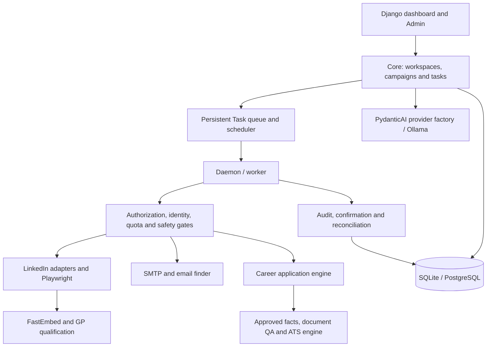

# Architecture

HuntFlow keeps the upstream `openoutreach` Python package name while providing its expanded dashboard and career workflow under the HuntFlow product name.

## Components

## Application boundaries

| Package | Responsibility |
|---|---|
| `core` | Configuration, workspaces/memberships, campaigns, queue state, scheduler, LLM factory, authorization and operational readiness |
| `linkedin` | Authenticated browser/session ownership, transport safety, discovery and enrichment, connection and follow-up tasks, provider evidence |
| `career` | Document ingestion, candidate facts/versions, job identities and matching, application drafts, approvals, screening and confirmation |
| `crm` | Leads, deals, import provenance, pipeline states and suppression |
| `emails` | Mailboxes, finder requests, SMTP delivery and channel tasks |
| `dashboard` | Forms, views and templates for the unified UI |
| `chat` | Conversation records and guided onboarding state |
| `packages/linkedin_agent_cli` | Bundled provider mechanics with browser-bound operations |

## Queue and execution

The source uses persistent task models and a custom daemon/scheduler rather than Celery. Task handlers advance discovery, qualification, connection, follow-up, email and career work. PostgreSQL is the deployment database; Redis supplies shared caching. Account/session leases and idempotency records aim to keep workers from duplicating external operations.

Queue state, a browser interaction, an attempted write, and a provider-confirmed result are separate concepts. Confirmation and reconciliation services exist because an interrupted transport can leave an uncertain result. Operators should inspect evidence before retrying.

## Machine-learning path

1. Profile text is transformed into a vector with FastEmbed's configured `BAAI/bge-small-en-v1.5` model (384 dimensions).
2. The LLM evaluates candidate suitability against campaign context and supplies qualification labels.
3. A standardized Gaussian Process regressor, with constant × RBF kernel, learns from the labeled vectors.
4. When negatives outnumber positives, acquisition favors predicted qualification. Otherwise, BALD information gain favors informative candidates.
5. Cold-start handling operates before both classes are available. The fitted campaign model is persisted in the private database, not in this source release.

This is active learning for prioritization, not a claim of calibrated hiring or lead-conversion prediction.

## Candidate and application path

Source documents produce extraction records and draft facts. Reviewed versions carry candidate identity and provenance. Job matching and ATS analysis compare approved facts against a job description. Drafting creates resume and cover-letter artifacts; document QA, approval and external-action gates precede provider submission. Screening answers are tied to candidate profile data, and unknown questions require review.

The implementation contains historical identity-resolution and forensic utilities tied to a particular version sequence. Their personal example values have been sanitized; they should be generalized before use in a new production deployment.

## Models and synchronous boundaries

`core/llm.py` routes `provider:model` names and runs PydanticAI coroutines on a persistent worker-thread event loop. This separates asynchronous model clients from the synchronous Playwright/Django caller. Ollama's ATS path has bounded inference concurrency, structured output checks and a local model fallback name. Hosted model availability is controlled by the operator's selected provider.

## Deployment layout

`docker-compose.production.yml` defines PostgreSQL, Redis, Ollama, web, worker, scheduler and browser-bootstrap services. Web/bootstrap ports bind to localhost. Volumes persist database contents, browser assets, private media and application state. Deploying the source requires independent environment configuration, TLS/proxy setup, secrets and backups; no original deployment access information is included.
